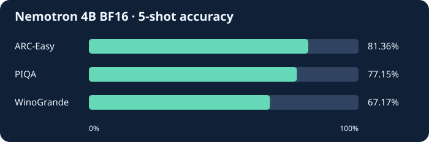

# LLM Compression Lab Notes

**How much accuracy can I retain while making a model smaller and faster?**

My experiment notes from NVIDIA's *The Art of Compressing LLMs*. The first milestone is an accuracy baseline for the original Nemotron model.

## Baseline results

| Benchmark | Accuracy | Length-normalized accuracy |
| :--- | ---: | ---: |
| ARC-Easy | 81.36% | 82.70% |
| PIQA | 77.15% | 77.75% |
| WinoGrande | 67.17% | — |

**Setup.** NVIDIA Nemotron 3 Nano 4B in BF16, evaluated with the Hugging Face backend of LM Evaluation Harness. Each task used five examples in the prompt, with batch size 32 and no example limit. The chart shows raw accuracy.

## Why prune a pretrained model?

Pruning removes selected parts of a trained model. **Depth pruning** removes entire layers. **Width pruning** removes structures inside layers, such as attention heads or feed-forward neurons.

- **The original idea.** Le Cun and colleagues estimated how much removing each weight would increase training loss, then removed weights with the smallest estimated impact. [Optimal Brain Damage (1989)](https://proceedings.neurips.cc/paper_files/paper/1989/file/6c9882bbac1c7093bd25041881277658-Paper.pdf)
- **The LLM application.** NVIDIA combined structured pruning with teacher-guided retraining to produce 8B and 4B models from Nemotron-4 15B. The study reports up to 40× fewer training tokens per smaller model compared with training from scratch. [Compact Language Models via Pruning and Knowledge Distillation (2024)](https://arxiv.org/pdf/2407.14679)

**What the lab tests.** Rerun ARC-Easy, PIQA, and WinoGrande after pruning and compare each score with its BF16 baseline. This measures the immediate accuracy change and gives a reference for evaluating how much accuracy distillation recovers.

## Experiment roadmap

| Stage | What I want to measure | Status |
| :--- | :--- | :--- |
| BF16 baseline | Reference accuracy on three tasks | Measured |
| Pruning | Accuracy change after removing model capacity | Planned |
| Distillation | Accuracy recovered through teacher supervision | Planned |
| Quantization | Effect of lower precision on accuracy and memory | Planned |
| Inference benchmarking | Latency and throughput under the same serving workload | Planned |

## Interview talking point

I measured the original model before applying compression. Using the same evaluation setup for each variant lets me compare accuracy in percentage points. A separate serving benchmark will show whether those accuracy trade-offs buy measurable improvements in latency or throughput.
